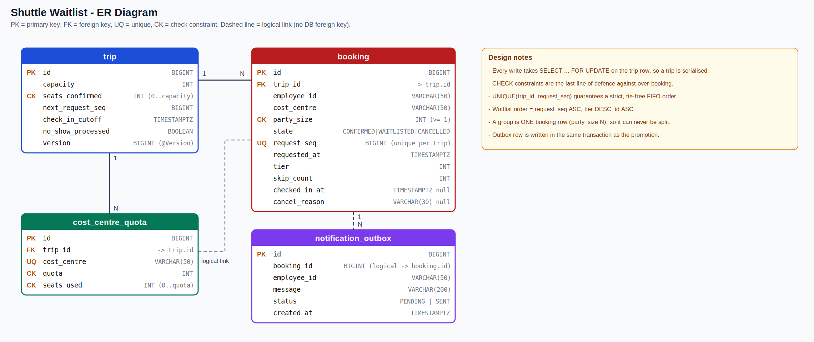

# Shuttle Waitlist & Fair Seat Promotion

Office shuttle seat booking with a fair waitlist. When a seat frees up, the right waitlisted
employee (or group) is promoted automatically, respecting both vehicle capacity and
per-cost-centre quotas, and without ever over-booking, even under concurrency.

Stack: Java 17, Spring Boot 4, Spring Data JPA (Hibernate 7), H2 (Postgres-compatible schema),
Flyway, Caffeine cache, Micrometer/Actuator, JUnit 5.
Layers: `controller -> service -> repository -> domain`.

## Run
```
.\mvnw.cmd spring-boot:run     # app on http://localhost:8080
.\mvnw.cmd clean test          # 20 tests, including concurrency tests
```
Every call needs headers `X-User: <id>` and `X-Role: EMPLOYEE | APPROVER | ADMIN`.

## Demo
- **Postman:** import `docs/Shuttle.postman_collection.json` and run requests 1-13 in order
  (or use the Collection Runner). Each request has assertions; all 13 pass.
- **PowerShell alternative:** `.\demo.ps1`
- Screenshots are in [`docs/`](docs/).

Demo scenario (from the case study): a 1-seat trip is full, a group of 2 and a single are
waitlisted, the seated person cancels -> the group of 2 is **skipped** (only 1 seat freed),
the single is **promoted** and gets an SMS (logged by the stub sender).

## API
| Method | Endpoint | Role |
|---|---|---|
| POST | `/trips` | ADMIN |
| PUT | `/trips/{id}/quotas` | ADMIN |
| GET | `/trips/{id}` (availability, waitlist length) | any |
| GET | `/trips/{id}/waitlist` | APPROVER / ADMIN |
| POST | `/trips/{id}/bookings` (`costCentre`, `partySize`, `tier`) | EMPLOYEE (201 seated, 202 waitlisted) |
| DELETE | `/bookings/{id}` | owner / ADMIN |
| POST | `/bookings/{id}/check-in` | EMPLOYEE (owner) |
| POST | `/trips/{id}/reclaim?force=true` | ADMIN |
| GET | `/actuator/metrics/shuttle.promotions` | any |

Errors are JSON: `{"code": "...", "message": "...", "timestamp": "..."}` with 400, 401, 403,
404 or 409. Stack traces are only logged, never returned.

## Data model


Full diagram and a Mermaid version: [docs/er-diagram.md](docs/er-diagram.md).

## Design
- **Per-trip serialisation.** Every book / cancel / check-in / reclaim / quota change starts with
  `SELECT ... FOR UPDATE` on the Trip row. Promotion runs in the same transaction, so two
  simultaneous cancellations promote exactly two people and the last seat is never sold twice.
- **Re-read after locking.** `cancel()` refreshes the booking after taking the lock, so two
  simultaneous cancels of the same booking free only one seat (covered by a test).
- **Defence in depth.** DB CHECK constraints (`seats_confirmed <= capacity`, `seats_used <= quota`),
  `@Version` on Trip, `UNIQUE (trip_id, request_seq)`.
- **Waitlist order.** `request_seq` (monotonic per trip, assigned under the lock) -> `tier DESC` -> `id`.
  FIFO wins over tier. Equal sequences cannot occur on one trip, so tier/id are deterministic backups.
- **Groups.** A group is one booking with `partySize`, promoted only if the whole party fits both
  vehicle capacity and its cost-centre quota. A skipped group keeps its place in line.
- **Quotas.** A freed seat can still be blocked by a full cost-centre quota; the next eligible
  person is promoted instead.
- **No-show reclaim.** A scheduler cancels unchecked-in CONFIRMED bookings (reason `NO_SHOW`)
  after the cut-off and promotes. Each trip is processed once, so re-running is safe.
- **Outbox.** Promotion writes a notification row in the same transaction. A dispatcher sends
  (stub SMS via `NotificationSender`) and retries rows that failed.
- **Metrics.** `shuttle.promotions`, `bookings`, `cancellations`, `quota_blocks`, `group_skips`,
  `no_show_reclaims`, `rejections`, `notifications_sent`.
- **Caching.** Caffeine cache on `GET /trips/{id}` (5 s TTL, max 500, evicted on every mutation).
  Stale: seat counts and waitlist length can lag up to 5 s. The booking path never reads the cache.

## Tests (20)
| Suite | What it proves |
|---|---|
| `BookingServiceTest` | confirm, waitlist when full, quota blocks despite free seats, FIFO order |
| `PromotionTest` | cancel promotes top single; group of 2 skipped when 1 seat frees; quota-blocked seat; idempotent cancel |
| `ConcurrencyTest` | 20 threads racing for the last seat; two simultaneous cancels -> exactly 2 promotions; same booking cancelled twice at once frees one seat |
| `ReclaimTest` | no-show reclaimed and next person promoted; idempotent; respects cut-off |
| `GroupAndTiebreakTest` | group of 3 boards only when 3 seats free; FIFO beats tier; duplicate booking rejected |

## Complexity
Promotion is O(W) per event (W = waitlist size) because it walks the ordered waitlist once.
Space is O(bookings). Possible optimisation: per-cost-centre queues plus a minimum-party-size
index to skip ineligible entries quickly.

## Trade-offs and what is not implemented
- **Auth is header-based** (`X-User`, `X-Role`), a demo simplification with no real authentication.
  Production would use JWT with Spring Security; `config/Auth` is the single place to replace.
- **Strict FIFO vs utilisation.** A group that does not fit is skipped so smaller people can board
  (higher utilisation, but a large group can wait longer). A starvation guard (reserve seats after
  N skips) is designed; `skip_count` is already tracked, but the reservation is not enforced.
- **Throughput.** One lock per trip limits a single hot trip, but trips are independent and scale
  across trips. Horizontal scale: shard by `tripId`.
- **Delivery.** The dispatcher polls every 5 s and is at-least-once (a crash between send and commit
  can resend). Production would add an idempotency key at the SMS provider.
- **Startup recovery** of trips with free seats and a waitlist is not implemented; the quota-update
  and reclaim paths re-run promotion.
- **Logging** is key=value text, not JSON.
- **Tier** comes from the request body for demo purposes; production would read it from the user record.
- H2 is in-memory: data is lost on restart. The schema is Postgres-compatible.

## Assumptions
One active booking per employee per trip; cancelling twice is a no-op; quotas are per trip per
cost centre; a cost centre must have a quota to book.
